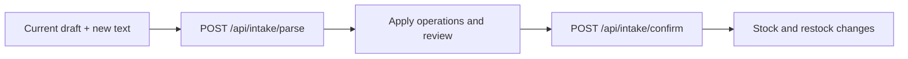

# AI-assisted stock intake

The app keeps the draft between requests. Parsing text suggests edits to that
draft. The user reviews the resulting items and confirms them as a batch.



Both endpoints require the shared API token.

## Parse text

Send `POST /api/intake/parse` with `Content-Type: application/json`.

```json
{
  "input": {"type": "text", "text": "Two bottles of milk"},
  "draft": {"items": []},
  "context": {"locale": "en", "timezone": "Asia/Tokyo", "purchase_date": "2026-11-20"}
}
```

Provide up to 100 draft candidates with unique temporary IDs. Text must have
1–4,000 characters after trimming. The optional context supplies the output
language, an IANA timezone and a default purchase date. Locale resolution uses
the request, the household setting, the `Accept-Language` header, then
`zh-CN`. Timezone resolution uses the request, the household setting, then
the server's local date. The purchase date defaults to that date.

The response contains `operations`, `unparsed_fragments`, `locale`, and
`warnings`. Apply operations to the current draft in the app.

```json
{
  "operations": [{
    "op": "add",
    "candidate": {
      "temporary_id": "cand_1a2b3c4d",
      "name": "Milk",
      "quantity_value": 2,
      "quantity_unit": "bottles",
      "category_id": 12,
      "purchase_date": "2026-11-20",
      "unopened_expiration_date": null,
      "suggested_unopened_expiration_date": "2026-11-27",
      "expiration_source": "estimated",
      "confidence": 0.9,
      "warnings": [{"code": "expiration_date_inferred", "params": {"basis": "category_default"}}],
      "source": {"input_kind": "text"}
    }
  }],
  "unparsed_fragments": [],
  "locale": "en",
  "warnings": []
}
```

The service also returns the candidate's optional fields, with `null` for
unknown values and an empty map for missing `field_confidence`.

| Operation | Fields | Conditions |
| --- | --- | --- |
| `add` | `candidate` | The server assigns a `cand_` ID. The candidate needs a name. |
| `update` | `temporary_id`, `changes` | The target must exist in the draft. Extra keys are discarded. |
| `delete` | `temporary_id`, `reason_code` | The target must exist. Reasons are `user_requested`, `duplicate`, and `non_product_line`. |
| `clarify` | `temporary_ids`, `question_code`, `question` | All targets must exist. The question must use the resolved locale and have 1–200 characters. Codes are `ambiguous_target`, `ambiguous_quantity`, and `ambiguous_date`. |

Model-editable fields are `name`, `quantity_value`, `quantity_unit`, `category_id`,
`owner`, `location`, `purchase_date`, `unopened_expiration_date`,
`suggested_unopened_expiration_date`, `expiration_source`, `notes`, and
`matched_restock_id`. A valid delete takes precedence over an update to the
same candidate. Parsing leaves inventory and restock records untouched.

### Expiration and restock suggestions

The model receives a 21-day calendar in the resolved timezone to interpret
relative dates. The backend validates model dates from 30 days before today
through five calendar years after today. A valid date explicitly marked
`stated` stays in `unopened_expiration_date`. Text input cannot supply a
`printed` date. An update preserves a previously trusted `printed` or
`stated` date when the model proposes a replacement without a stated source.

When there is no trusted date, the category default takes precedence. The
backend adds the default number of days to the purchase date and reports any
discarded model date in `ai_expiration_ignored`. With no category default,
a valid untrusted date moves to `suggested_unopened_expiration_date`. An
estimate uses the `estimated` source. A date before the purchase date is
kept with a warning. Updates calculate from the changed category and purchase
date, falling back to the current draft fields when omitted.

The backend validates matches against pending restock items. A matching unit
and enough quantity yield `done`. A short quantity in the same unit yields
`partial`. Different units or missing quantities yield `none`. For an add
operation, the result is `candidate.restock_action`. For an update to
`matched_restock_id`, `quantity_value`, or `quantity_unit`, the backend
recalculates from the merged candidate and returns `changes.restock_action`.
A cleared link yields `null`. Other updates keep the current action. Apply
all returned changes normally, including fields written by the backend.

## Confirm the reviewed draft

Send `POST /api/intake/confirm` with 1–100 reviewed items. Optional `defaults`
apply to items that omit or send `null` for `owner` and `location`. Include a
unique temporary ID, a name, a valid category, positive quantity, unit, and
unopened expiration date for each item. Use a date in `YYYY-MM-DD` format or
`infinite`. The purchase date defaults to today in the household timezone.

```json
{
  "defaults": {"owner": "me", "location": "Fridge"},
  "items": [{
    "temporary_id": "cand_1a2b3c4d",
    "name": "Milk",
    "category_id": 12,
    "quantity_value": 2,
    "quantity_unit": "bottles",
    "unopened_expiration_date": "2026-11-27",
    "matched_restock_id": 7,
    "restock_action": "done"
  }]
}
```

Successful confirmation returns HTTP 201.

```json
{
  "created": [{"temporary_id": "cand_1a2b3c4d", "item_id": 41}],
  "restock_done": [7],
  "restock_partial": [],
  "warnings": []
}
```

The backend derives the effective expiration and status using the regular item
creation rules. It commits the whole batch together. A bad item rejects the
batch with HTTP 422. `intake_item_invalid` includes the zero-based `index`,
`temporary_id` and `field` of the invalid value.

For a pending restock match, `done` completes the entry, `partial` applies the
stock quantity against the remaining quantity, and `none` or an omitted action
leaves the restock entry as it was. An entry already completed, changed
concurrently, or already acted on in the same request produces
`restock_already_done` with `restock_id`. The reviewed stock item is still saved.

## Errors and warnings

Intake errors use `code`, `params`, and English `detail`. AI errors use the
shared AI API response with `code`. Invalid request shapes use FastAPI's
standard validation response.

| HTTP | Error code | Parameters |
| --- | --- | --- |
| 422 | `intake_text_empty` | |
| 422 | `intake_text_too_long` | `max` |
| 422 | `intake_draft_too_large` | `max` |
| 422 | `intake_duplicate_temporary_id` | `id` |
| 422 | `intake_timezone_invalid` | |
| 422 | `intake_item_invalid` | `index`, `temporary_id`, `field` |
| 502 | `ai_upstream_error` | |
| 503 | `ai_unavailable` | |

Warnings use `{code, params}` with string parameter values. Operation indexes
are zero-based positions in the model reply.

| Warning code | Parameters | Meaning |
| --- | --- | --- |
| `locale_fallback` | `requested` | The requested output locale fell back to a supported locale. |
| `op_invalid` | `index` | An operation or its fields failed validation. |
| `op_target_unknown` | `index` | An operation referenced a missing draft item. |
| `op_conflict` | `index` | A delete took precedence over this update. |
| `ops_dropped` | `count` | Number of operations discarded from the reply. |
| `op_field_dropped` | `field`, `index` | An update attempted to change a field outside the editable list. |
| `field_value_dropped` | `field` | A value was unusable. |
| `quantity_dropped` | `field` | A quantity was invalid. |
| `category_dropped` | `field` | The category could not be found. |
| `date_dropped` | `field` | A date was invalid or outside the allowed range. |
| `expiration_moved_to_suggested` | | An untrusted date became a suggestion. |
| `expiration_date_inferred` | `basis` | The backend calculated a suggestion using `category_default`. |
| `ai_expiration_ignored` | `date` | A model date was discarded in favor of a category estimate or a trusted draft date. |
| `expiration_before_purchase` | | The returned expiration date is before the purchase date. |
| `restock_match_dropped` | `field` | The referenced restock item was unavailable or no longer pending. |
| `restock_already_done` | `restock_id` | Confirmation saved stock and skipped the restock action. |

## Default shelf life

`default_shelf_life_days` is a category setting the intake flow uses to
estimate `suggested_unopened_expiration_date` from an item's purchase date.
The estimated date stays a suggestion until the user confirms an expiration date.

Category responses include this nullable field. Category creation and updates
accept an integer from 1 through 3650 days or `null`. Omit the field from a
PATCH request to keep the current value, or send `null` to clear it.

| Category slug | Days | Category slug | Days |
| --- | ---: | --- | ---: |
| `vegetables` | 7 | `fruit` | 7 |
| `meat` | 3 | `seafood` | 2 |
| `eggs` | 30 | `dairy` | 7 |
| `staples_grains` | 180 | `soy_products` | 5 |
| `seasonings_spices` | 365 | `baking` | 180 |
| `drinks` | 180 | `snacks` | 90 |
| `frozen_food` | 90 | `canned_packaged` | 365 |
| `ready_to_eat` | 2 | `other_food` | `null` |
| `baby_food` | 30 | `formula` | 365 |
| `pet_food` | 180 | `pet_treats` | 180 |
| `medicine` and `supplements` | `null` | All other categories | `null` |
