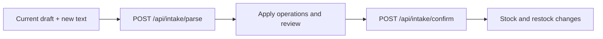

# AI-assisted stock intake

The app keeps the draft between requests. Parsing text suggests edits to that
draft. The user reviews the resulting items and confirms them as a batch.



Both endpoints require the shared API token.

## Transcribe a recording

Call `POST /api/speech/transcribe` with the shared API token and
`multipart/form-data`. Send one file in `audio` and optionally set `feature`
to `stock_intake` or `recipe_explore` for server logs. DeepSeek detects the
spoken language automatically. The API returns the transcript and duration
in milliseconds. The app can use the transcript as text for the intake draft.

```json
{"transcript": "Two bottles of milk", "duration_ms": 5230}
```

The audio file can be up to 8,388,608 bytes and 120 seconds. The backend
accepts 16-bit PCM WAV or Ogg Opus and checks the file contents before upload
to DeepSeek. WAV supports mono or stereo at 8000, 16000, 22050, 24000, 32000,
44100, or 48000 Hz. For iOS, record 16-bit mono PCM WAV at 16000 Hz and stop
at 120 seconds. Stereo WAV includes
`"warnings": [{"code": "audio_stereo_left_only"}]` because DeepSeek recognizes
only the left channel.

Use `GET /api/capabilities` and check `ai.asr` before offering recording.
Transcription errors use the API's standard `code` and `params` fields.

| Code | HTTP | Meaning |
| --- | --- | --- |
| `asr_unavailable` | 503 | Speech transcription is disabled or lacks a key. |
| `audio_upload_invalid` | 422 | The multipart form is malformed, a field is invalid, or the file is missing. |
| `audio_too_large` | 413 | The upload exceeds the size limit. |
| `audio_format_unsupported` | 422 | The audio format is invalid or unsupported. |
| `audio_too_long` | 422 | The recording exceeds 120 seconds. |
| `asr_upstream_error` | 502 | DeepSeek failed to transcribe the recording. |

## Parse text

Send `POST /api/intake/parse` with `Content-Type: application/json`.

```json
{
  "input": {"type": "text", "text": "Two bottles of milk"},
  "draft": {"items": []},
  "context": {"locale": "en", "timezone": "Asia/Tokyo", "purchase_date": "2026-11-20"}
}
```

Provide up to 100 draft candidates. For a candidate created by the app,
`temporary_id` must be unique within the draft and consist of `cand_` followed
by exactly eight lowercase hexadecimal digits (for example, `cand_1a2b3c4d`).
The fields `confidence` and `source.input_kind` are required.

Text must have 1–4,000 characters after trimming. The optional context supplies the output
language, an IANA timezone and a default purchase date. Locale resolution uses
the request, the household setting, the `Accept-Language` header, then
`zh-CN`. Timezone resolution uses the request, the household setting, then
the server's local date. The purchase date defaults to that date.

The response contains `operations`, `unparsed_fragments`, `locale`, and
`warnings`. Apply operations to the current draft in the app.

```json
{
  "operations": [{
    "op": "add",
    "candidate": {
      "temporary_id": "cand_1a2b3c4d",
      "name": "Milk",
      "quantity_value": 2,
      "quantity_unit": "bottles",
      "category_id": 12,
      "purchase_date": "2026-11-20",
      "unopened_expiration_date": null,
      "suggested_unopened_expiration_date": "2026-11-27",
      "expiration_source": "estimated",
      "confidence": 0.9,
      "warnings": [{"code": "expiration_date_inferred", "params": {"basis": "category_default"}}],
      "source": {"input_kind": "text"}
    }
  }],
  "unparsed_fragments": [],
  "locale": "en",
  "warnings": []
}
```

The service also returns the candidate's optional fields, with `null` for
unknown values and an empty map for missing `field_confidence`.

| Operation | Fields | Conditions |
| --- | --- | --- |
| `add` | `candidate` | The server assigns a `cand_` ID. The candidate needs a name. |
| `update` | `temporary_id`, `changes` | The target must exist in the draft. Extra keys and invalid values are discarded with warnings. An explicit `null` can clear a field. An empty update is discarded. |
| `delete` | `temporary_id`, `reason_code` | The target must exist. Reasons are `user_requested`, `duplicate`, and `non_product_line`. |
| `clarify` | `temporary_ids`, `question_code`, `question` | All targets must exist. The question must use the resolved locale and have 1–200 characters. Codes are `ambiguous_target`, `ambiguous_quantity`, and `ambiguous_date`. |

Model-editable fields are `name`, `quantity_value`, `quantity_unit`, `category_id`,
`owner`, `location`, `purchase_date`, `unopened_expiration_date`,
`suggested_unopened_expiration_date`, `expiration_source`, `notes`, and
`matched_restock_id`. A valid delete takes precedence over an update to the
same candidate. Parsing leaves inventory and restock records untouched.

### Expiration and restock suggestions

The model receives a 21-day calendar in the resolved timezone to interpret
relative dates. The backend validates model dates from 30 days before today
through five calendar years after today. A valid date explicitly marked
`stated` stays in `unopened_expiration_date`. Text input cannot supply a
`printed` date. An update preserves a previously trusted `printed` or
`stated` date when the model proposes a replacement without a stated source.

When there is no trusted date, the category default takes precedence. The
backend adds the default number of days to the purchase date and reports any
discarded model date in `ai_expiration_ignored`. With no category default,
a valid untrusted date moves to `suggested_unopened_expiration_date`. An
estimate uses the `estimated` source. A date before the purchase date is
kept with a warning. Updates calculate from the changed category and purchase
date, falling back to the current draft fields when omitted.
On add, a missing or invalid purchase date uses the context's default purchase
date. An invalid model date still produces `date_dropped`.

The backend validates matches against pending restock items. A matching unit
and enough quantity yield `done`. A short quantity in the same unit yields
`partial`. Different units or missing quantities yield `none`. For an add
operation, the result is `candidate.restock_action`. For an update to
`matched_restock_id`, `quantity_value`, or `quantity_unit`, the backend
recalculates from the merged candidate and returns `changes.restock_action`.
A cleared link yields `null`. A quantity or unit change on an unlinked
candidate omits the action. Other updates keep the current action. Apply
all returned changes normally, including fields written by the backend.

## Parse images

Use the same `POST /api/intake/parse` endpoint with `multipart/form-data`.
The `payload` field is a JSON string containing `draft` and optional
`context`. Repeat the `images` field once per uploaded file.

```bash
curl -X POST "$STOCK_API_URL/api/intake/parse" \
  -H "Authorization: Bearer $STOCK_API_TOKEN" \
  -F 'payload={"draft":{"items":[]},"context":{"locale":"en"}}' \
  -F 'images=@receipt-a.jpg' \
  -F 'images=@receipt-b.jpg'
```

Send one to eight files per request. Each file can have up to 5,242,880 bytes,
and the JSON `payload` can have up to 262,144 bytes. The full multipart request,
including headers and boundaries, can have up to 42,270,720 bytes.
The backend identifies JPEG, PNG, and WebP from their file signatures. For a
larger batch, apply the returned operations to the current draft and submit
that updated draft with the next batch of images.

Each returned image operation includes `source.input_kind`
(`receipt`, `product_closeup`, or `product_overview`) and a zero-based
`source.image_index` in upload order. An add operation also copies that source
to the candidate. Existing text operations retain their response shape.
Images are sent to the configured AI provider for parsing. The backend keeps
uploads in memory and logs the count and total bytes.

Check `GET /api/capabilities` for `ai.vision` before offering image intake.
It requires a configured AI provider and `AI_VISION_ENABLED=true`.
The switch defaults to off pending provider validation. See [backend setup](setup.md).

### Product photos and printed dates

A close-up can add a product or update a matching item already in the draft,
such as a candidate from a receipt. The model reports structured label
evidence. The backend calculates the expiration date and returns the usual
candidate or update fields.

When a close-up matches a new receipt row in the same upload, the result can
be a single receipt `add` with the date derived from the other image. The
operation keeps the receipt as its source. The backend checks that the label
evidence points to a different image in the batch.

- For `best_before` and `use_by`, the printed date is the expiration date.
- For `production_plus_shelf_life`, the backend adds the displayed shelf life
  to the production date. Days use elapsed calendar days. Months and years
  keep the day of the month when possible and use the last day otherwise.
- A readable, valid result within the allowed date window is returned in
  `unopened_expiration_date` with `expiration_source: "printed"`.
  The window runs from 30 days before today to five calendar years after today.
- An unclear label or out-of-range result adds `printed_date_unclear`. A date
  that can be calculated is returned in `suggested_unopened_expiration_date`.
  A previously trusted draft date stays in place when the new label is unclear.
  Labels showing only a year and month are treated as unclear.
  Evidence from an ineligible source is discarded with `printed_evidence_dropped`.

An overview photo produces one `add` per recognizable item. Inferred
quantities carry `quantity_value_inferred` with a
`field_confidence.quantity_value` of at most 0.5.

## Receipt lines and learned aliases

Receipt text and receipt photos use the same parse endpoints. Receipt lines
appear as separate `add` operations, with subtotals, taxes, coupons, and other
non-product lines in `unparsed_fragments`. Receipt candidates can include
`raw_name`, `generic_name`, `store_name`, `price`, `specificity`,
`alias_mode`, `auto_apply_allowed`, `requires_user_review`, `review_reason`,
`match_method`, and up to five `suggestions` ranked by confirmation count.
Prices are only used during review. A receipt purchase date can fill in an
omitted `context.purchase_date`, with a `purchase_date_from_receipt` warning.

Confirm a receipt candidate with its `raw_name`, `store_name`, and
`specificity` along with the reviewed item fields. The service learns the
mapping in the same transaction as the inventory and restock changes.
Only items with receipt `specificity` and a raw label contribute to alias
history.
History is scoped to the normalized store and receipt label. A receipt with
an unknown store has its own history. The receipt label is normalized for
case, width, whitespace, and recognizable trailing prices and quantities.

| Mode | Behavior |
| --- | --- |
| `auto` | A specific label with at least three confirmations of exactly one name can reuse the confirmed name, category, and unit with `match_method=alias`. A deleted category makes that mapping reviewable. |
| `suggest` | The proposed name stays editable and prior confirmed names appear as suggestions. A label associated with multiple distinct confirmed names stays in this mode. |
| `blocked` | The stored mapping stays blocked from automatic reuse. |

Generic labels such as “produce” and “蔬菜” always require review, including
after repeated confirmations. The candidate has `name: null` so the user can
choose or enter a specific item. Distinct rows with the same generic label
remain separate. Repeated rows on one receipt after the first include
`duplicate_generic_line`. Other review reasons include `first_seen`,
`low_confidence` (below 0.6), `multi_mapped_alias`, `inferred_fields`, and
`alias_suggestion`.

`RECEIPT_PRODUCT_LOOKUP_PROVIDER=none` is the available lookup mode. First-seen
labels use `match_method=ai_knowledge`. Future providers plug into
`receipt_lookup.lookup_products(raw_names, store)`, whose inputs are limited
to the store and raw item labels.

## Confirm the reviewed draft

Send `POST /api/intake/confirm` with 1–100 reviewed items. Optional `defaults`
apply to items that omit or send `null` for `owner` and `location`. Include a
unique temporary ID, a name, a valid category, positive quantity, unit, and
unopened expiration date for each item. Use a date in `YYYY-MM-DD` format or
`infinite`. The purchase date defaults to today in the household timezone.

```json
{
  "defaults": {"owner": "me", "location": "Fridge"},
  "items": [{
    "temporary_id": "cand_1a2b3c4d",
    "name": "Milk",
    "category_id": 12,
    "quantity_value": 2,
    "quantity_unit": "bottles",
    "unopened_expiration_date": "2026-11-27",
    "matched_restock_id": 7,
    "restock_action": "done"
  }]
}
```

Successful confirmation returns HTTP 201.

```json
{
  "created": [{"temporary_id": "cand_1a2b3c4d", "item_id": 41}],
  "restock_done": [7],
  "restock_partial": [],
  "warnings": []
}
```

The backend derives the effective expiration and status using the regular item
creation rules. It commits the whole batch together. A bad item rejects the
batch with HTTP 422. `intake_item_invalid` includes the zero-based `index`,
`temporary_id` and `field` of the invalid value.

For a pending restock match, `done` completes the entry, `partial` applies the
stock quantity against the remaining quantity, and `none` or an omitted action
leaves the restock entry as it was. An entry already completed, changed
concurrently, or already acted on in the same request produces
`restock_already_done` with `restock_id`. The reviewed stock item is still saved.

## Errors and warnings

Intake errors use `code`, `params`, and English `detail`. AI errors use the
shared AI API response with `code`. Invalid request shapes use FastAPI's
standard validation response.

| HTTP | Error code | Parameters |
| --- | --- | --- |
| 413 | `intake_request_too_large` | `max_bytes` |
| 422 | `intake_text_empty` | |
| 422 | `intake_text_too_long` | `max` |
| 422 | `intake_draft_too_large` | `max` |
| 422 | `intake_duplicate_temporary_id` | `id` |
| 422 | `intake_timezone_invalid` | |
| 422 | `intake_images_missing` | |
| 422 | `intake_multipart_invalid` | |
| 422 | `intake_images_too_many` | `max` |
| 422 | `intake_image_too_large` | `index`, `max_bytes` |
| 422 | `intake_image_type_unsupported` | `index` |
| 422 | `intake_item_invalid` | `index`, `temporary_id`, `field` |
| 502 | `ai_upstream_error` | |
| 503 | `ai_unavailable` | |
| 503 | `ai_vision_unavailable` | |

Warnings use `{code, params}` with string parameter values. Operation indexes
are zero-based positions in the model reply.

| Warning code | Parameters | Meaning |
| --- | --- | --- |
| `locale_fallback` | `requested` | The requested output locale fell back to a supported locale. |
| `op_invalid` | `index` | An operation or its fields failed validation. |
| `op_target_unknown` | `index` | An operation referenced a missing draft item. |
| `op_conflict` | `index` | A delete took precedence over this update. |
| `ops_dropped` | `count` | Number of operations discarded from the reply. |
| `op_field_dropped` | `field`, `index` | An update attempted to change a field outside the editable list. |
| `field_value_dropped` | `field` | A value was unusable. |
| `quantity_dropped` | `field` | A quantity was invalid. |
| `category_dropped` | `field` | The category could not be found. |
| `date_dropped` | `field` | A date was invalid or outside the allowed range. |
| `expiration_moved_to_suggested` | | An untrusted date became a suggestion. |
| `expiration_date_inferred` | `basis` | The backend calculated a suggestion using `category_default`. |
| `ai_expiration_ignored` | `date` | A model date was discarded in favor of a category estimate or a trusted draft date. |
| `expiration_before_purchase` | | The returned expiration date is before the purchase date. |
| `printed_date_unclear` | | A close-up label lacks usable evidence or yields an out-of-range date. A calculable date is kept as a suggestion. |
| `printed_evidence_dropped` | | The label was attached to an unsupported operation or referenced an ineligible image index. |
| `quantity_value_inferred` | | An overview photo did not establish the exact quantity. |
| `restock_match_dropped` | `field` | The referenced restock item was unavailable or no longer pending. |
| `restock_already_done` | `restock_id` | Confirmation saved stock and skipped the restock action. |
| `duplicate_generic_line` | | This generic label occurs on more than one row of the receipt. |
| `purchase_date_from_receipt` | | The candidate purchase date came from a receipt. |
| `quantity_unit_inferred`, `location_inferred` | `field` | A receipt field was inferred and can be reviewed. |

## Default shelf life

`default_shelf_life_days` is a category setting the intake flow uses to
estimate `suggested_unopened_expiration_date` from an item's purchase date.
The estimated date stays a suggestion until the user confirms an expiration date.

Category responses include this nullable field. Category creation and updates
accept an integer from 1 through 3650 days or `null`. Omit the field from a
PATCH request to keep the current value, or send `null` to clear it.

| Category slug | Days | Category slug | Days |
| --- | ---: | --- | ---: |
| `vegetables` | 7 | `fruit` | 7 |
| `meat` | 3 | `seafood` | 2 |
| `eggs` | 30 | `dairy` | 7 |
| `staples_grains` | 180 | `soy_products` | 5 |
| `seasonings_spices` | 365 | `baking` | 180 |
| `drinks` | 180 | `snacks` | 90 |
| `frozen_food` | 90 | `canned_packaged` | 365 |
| `ready_to_eat` | 2 | `other_food` | `null` |
| `baby_food` | 30 | `formula` | 365 |
| `pet_food` | 180 | `pet_treats` | 180 |
| `medicine` and `supplements` | `null` | All other categories | `null` |
